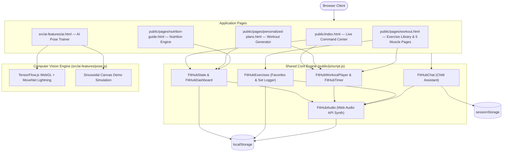
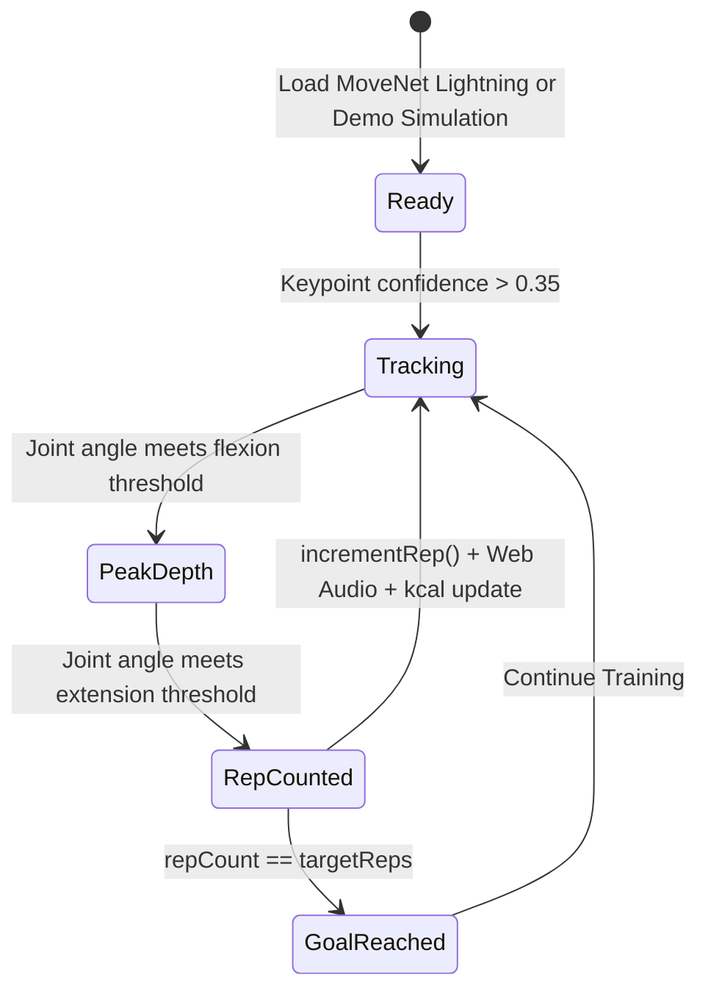
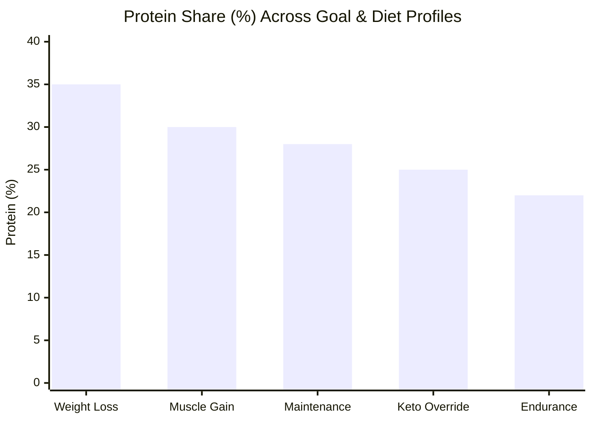
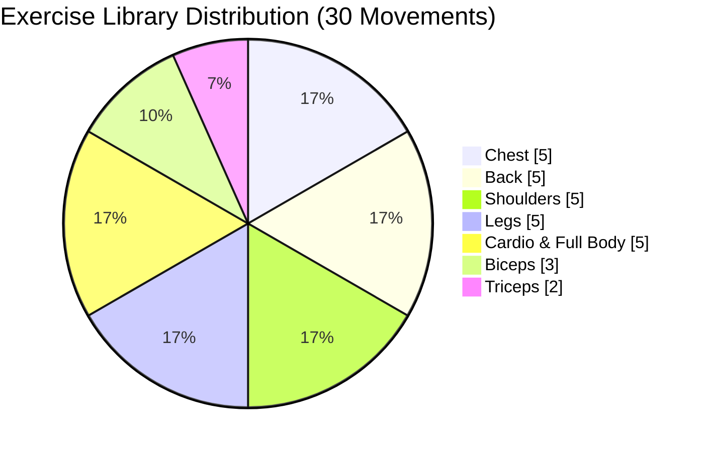

# FitHub 


A high-performance, client-side fitness trainer platform featuring real-time computer vision pose tracking, Google Gemini AI fitness coaching, interactive biometric dashboards, algorithm-driven workout generation, and scientific nutrition planning.

---

## Highlights

| Pillar | Implementation | Key Benefit |
| :--- | :--- | :--- |
| **Zero-Build Runtime** | Native HTML5, CSS3, and ES6+ JavaScript | Runs directly via any static HTTP server with no bundler or transpiler |
| **Pure Black UI/UX** | `#000000` canvas, `#ffffff` accents, `rgba(255,255,255,0.14)` hairlines | High-contrast dark interface across desktop and mobile |
| **2-Tier Card System** | `.fithub-card-outer` &rarr; `.fithub-card-inner` + divider rows | Consistent, clutter-free visual hierarchy without nested box bloat |
| **On-Device Computer Vision** | TensorFlow.js WebGL + MoveNet Lightning (`pose.js`) | Private 17-keypoint tracking, live joint angle HUD, and 640&times;480 demo mode |
| **Offline-First Intelligence** | Client-side formulas, `FitHubChat` knowledge engine, `localStorage` | Works out-of-the-box without external backend servers or paid APIs |
| **Audio & Dock UX** | Web Audio API synth tones + persistent floating dock & rest timer | Responsive workout pacing with tactile audio cues and mute persistence |

---

## System Architecture



### Page & Module Directory

| Module | File Path | Primary Responsibility | Interactive Controls |
| :--- | :--- | :--- | :--- |
| **Command Center** | `public/index.html` | Activity rings, biometric sliders, habit streak, guided workouts | `+10/+25 Reps`, `+1 Cup`, BMI sliders, 7-day check-in pills, push-up challenge |
| **AI Pose Trainer** | `src/ai-features/ai.html` | Live webcam & simulated pose estimation, rep counting, pace/kcal | Camera start, Demo Simulation, exercise selector, rep goal preset, sound toggle |
| **Workout Generator** | `public/pages/personalized-plans.html` | Equipment-aware 7-day split builder with plan saving & `.txt` export | Biometrics form, 6 equipment toggles, day tabs, exercise swap, saved plan loader |
| **Nutrition Engine** | `public/pages/nutrition-guide.html` | Mifflin-St Jeor BMR/TDEE, goal macros, 7-day meals, water tracker | Goal/activity/diet selectors, allergy filter, meal swap, grocery checklist, `.txt` export |
| **Exercise Library** | `public/pages/workout.html` | Unified 30-exercise catalog with live search and category chips | Search bar, 8 filter chips (+ Favorites), star bookmarks, set logger drawer, timers |
| **Muscle Pages (5)** | `public/pages/{chest,back,biceps-triceps,shoulder,leg}.html` | Focused 5-exercise views per muscle group | Search filter, favorites, inline set logger, rest timer triggers |

---

## Core Features & Classifications

### 1. Live Training Command Center (`public/index.html` & `public/js/script.js`)

#### Daily Activity Rings & Trackers

| Tracker | Default Target | Increment Actions | Visual / Audio Feedback | Persistence |
| :--- | :--- | :--- | :--- | :--- |
| **Movement Ring** | `50 Reps` | `+10 Reps`, `+25 Reps`, Set Logger, Guided Player | Animated SVG stroke ring (`#ringBarMove`) + success chime | `localStorage` (`fithub_interactive_state`) |
| **Hydration Ring** | `8 Cups` (`2.0 L`) | `+1 Cup` (`250 mL`), 8-glass interactive tracker | SVG ring (`#ringBarWater`) + water chime + goal chime at `8/8` | `fithub_interactive_state` & `fithub_water_tracker` |
| **Energy Ring** | `400 kcal` | Auto-calculated from logged reps (`~0.35–0.4 kcal/rep`) | SVG ring (`#ringBarCal`) + live counter | `fithub_interactive_state` |
| **Daily Push-Up Challenge** | `30 Push-Ups` | `-1`, `+1 Push-Up`, `+5 Push-Ups` | Progress bar fill (`0–100%`) + completion chime | `fithub_interactive_state` |
| **Weekly Habit Streak** | `Mon–Sun` Pills | Tap any day pill to toggle check-in | Checkmark toggle + live streak counter (starts at `3`) | `fithub_interactive_state` |

#### Biometric Projector & BMI Classification

Draggable sliders compute live metrics over `Weight (40–160 kg, step 0.5)` and `Height (130–220 cm, step 1)`:

| Metric / Category | Formula / Threshold | Output Format |
| :--- | :--- | :--- |
| **Body Mass Index (BMI)** | `weight / (height / 100)²` | Rounded to `0.1` |
| **Underweight** | `BMI < 18.5` | Status pill: `Underweight` |
| **Normal** | `18.5 ≤ BMI < 25.0` | Status pill: `Normal` |
| **Overweight** | `25.0 ≤ BMI < 29.9` | Status pill: `Overweight` |
| **Obese** | `BMI ≥ 30.0` | Status pill: `Obese` |
| **Recommended Water** | `weight × 0.033` | `L / day` |
| **Maintenance Estimate** | `10w + 6.25h − 5(25) + 5` | `~kcal` |

> **Global Floating Controls:** Every page injects the **Floating Bottom Dock** (`Start Workout`, `Rest`, `+1 Cup`, `Chitti`), the **Guided Workout Player** (`quick` 15-Minute Full Body Power & `chest` Heavy Chest Builder routines), and the **Dockable Rest Timer** (`30s`, `60s`, `90s`, `120s` presets with `-15s` / `+15s` live controls).

---

### 2. Real-Time AI Pose Trainer (`src/ai-features/ai.html` & `pose.js`)

Runs TensorFlow.js MoveNet (`Lightning`) on WebGL entirely in-browser alongside a built-in `640x480` sinusoidal **Demo Simulation** mode (`2.4s` per rep cycle) for camera-free testing.



#### Exercise Detection & Rep Threshold Classification

| Exercise Mode | Value Key | Tracked Landmarks | Active / Peak Threshold | Completion / Reset Threshold | Est. Burn Rate |
| :--- | :--- | :--- | :--- | :--- | :--- |
| **Squats** | `squat` | Hip &rarr; Knee &rarr; Ankle | Knee angle `<= 95°` (`90°` arc) | Knee angle `>= 160°` | `0.35 kcal/rep` |
| **Push-Ups** | `pushup` | Shoulder &rarr; Elbow &rarr; Wrist | Elbow angle `<= 90°` | Elbow angle `>= 155°` | `0.42 kcal/rep` |
| **Bicep Curls** | `bicep_curl` | Shoulder &rarr; Elbow &rarr; Wrist | Arm angle `<= 55°` | Arm angle `>= 150°` | `0.20 kcal/rep` |
| **Jumping Jacks** | `jumping_jack` | Wrists, Shoulders, Ankles | Wrists above shoulders & `ankleDist > 1.35 * shoulderDist` | Wrists down & feet together | `0.25 kcal/rep` |

#### Target Rep Presets & Feedback States

| Configuration / State | Options / Behavior |
| :--- | :--- |
| **Target Rep Goals** | `5` (Quick Set) · `10` (Standard Set, default) · `15` (Hypertrophy) · `20` (Endurance) · `0` (Unlimited) |
| **Feedback Statuses** | `good` (high-contrast white border) · `warning` (depth/range cue) · `neutral` (framing prompt) |
| **Live Telemetry** | Elapsed timer (`MM:SS`), calories burned (`kcal`), repetition pace (`/min` after `10s`) |

---

### 3. Personalized Workout Generator (`public/pages/personalized-plans.html`)

#### Input Parameter & Adaptation Matrix

| Input Dimension | Supported Classifications / Options |
| :--- | :--- |
| **Biometrics** | Age (`16–100`), Gender (`male`, `female`, `other`), Height (`100–250 cm`), Weight (`30–200 kg`) |
| **Primary Goal (5)** | `weight-loss` · `muscle-gain` · `endurance` · `strength` · `general-fitness` |
| **Experience Level (3)** | `beginner` (`0–6 months`) · `intermediate` (`6–24 months`) · `advanced` (`2+ years`) |
| **Session Duration (5)** | `20 min` (Quick HIIT) · `30 min` · `45 min` · `60 min` (Standard) · `90 min` (Intensive) |
| **Weekly Frequency (4)** | `3` · `4` · `5` · `6` Days / Week |
| **Equipment Toggles (6)** | Bodyweight Only · Dumbbells · Resistance Bands · Barbell & Plates · Treadmill/Cardio · Gym Machines |
| **Plan Utilities** | Exercise alternative cycling (`🔄 Swap`), completion checkboxes, rest timer launch, `localStorage` save/load, `.txt` export, print view |

<details>
<summary><strong>Expand 7-Day Split Structure & Equipment Adaptation Logic</strong></summary>

| Day | Focus | Primary Selection Logic | Volume & Rest |
| :--- | :--- | :--- | :--- |
| **Monday** | Upper Body Power | Chest (Barbell/Dumbbell/Push-Up) + Back (Barbell/Dumbbell/Inverted Row) + Shoulders | `3–4 Sets`, `8–12 Reps`, `45–60s` rest |
| **Tuesday** | Lower Body & Core | Squat variant + Romanian Deadlifts + Plank & Hanging Knee Raises | `3–4 Sets`, `10–12 Reps` / `30–45s`, `45–60s` rest |
| **Wednesday** | Active Recovery | Light Mobility & Hip Openers + Brisk Incline Walk / Cycling | `1–2 Sets`, `10–25 Mins`, `30–60s` rest |
| **Thursday** | Push Hypertrophy | Incline Dumbbell Press + Dumbbell Lateral Raises + Tricep Pushdowns / Dips | `3–4 Sets`, `10–15 Reps`, `45–60s` rest |
| **Friday** | Pull & Legs | Wide-Grip Lat Pulldowns + Walking Lunges + Standing Dumbbell Bicep Curls | `3–4 Sets`, `10–12 Reps`, `45–60s` rest |
| **Saturday** | Cardio / Full Body HIIT | Interval Cardio Sprints (if cardio equipment selected) or Burpees/Mountain Climbers + Leg Raises | `3–5 Sets/Rounds`, `45–60s` rest |
| **Sunday** | Complete Rest | Full Rest & Recovery Day (with Meditation / Nature Walk alternatives) | Full Day (`0s` rest) |

</details>

---

### 4. Scientific Nutrition & Macro Engine (`public/pages/nutrition-guide.html`)

#### Metabolic & Activity Multiplier Classification (Mifflin-St Jeor)

- **BMR (Male):** `10 × weight(kg) + 6.25 × height(cm) − 5 × age + 5`
- **BMR (Female / Other):** `10 × weight(kg) + 6.25 × height(cm) − 5 × age − 161`

| Activity Tier | Option Value | Description | TDEE Multiplier |
| :--- | :--- | :--- | :--- |
| **Sedentary** | `sedentary` | Desk job, minimal movement | `1.2` |
| **Light** | `light` | 1–3 workout days | `1.375` |
| **Moderate** | `moderate` | 3–5 workout days | `1.55` |
| **Active** | `active` | 6–7 workout days | `1.725` |
| **Very Active** | `very-active` | Athlete / physical labor | `1.9` |

#### Calorie Adjustment & Macronutrient Split Classification

| Goal / Diet Mode | Daily Calorie Target | Protein (`4 kcal/g`) | Carbs (`4 kcal/g`) | Fat (`9 kcal/g`) |
| :--- | :--- | :--- | :--- | :--- |
| **Weight Loss** (`weight-loss`) | `TDEE - 450 kcal` | `35%` | `35%` | `30%` |
| **Muscle Gain** (`muscle-gain`) | `TDEE + 350 kcal` | `30%` | `45%` | `25%` |
| **Maintenance** (`maintenance`) | `TDEE` | `28%` | `42%` | `30%` |
| **Endurance** (`endurance`) | `TDEE + 150 kcal` | `22%` | `55%` | `23%` |
| **Keto Override** (`diet === 'keto'`) | Goal-adjusted `TDEE` | `25%` | `5%` | `70%` |



#### Dietary Preferences & Meal Blueprint Features

| Diet Option | Meal Pool Source | Meal Timing & Interactive Tools |
| :--- | :--- | :--- |
| `omnivore`, `vegetarian`, `vegan` | Dedicated recipe pools (`breakfast`, `lunch`, `dinner`, `snack`) in `masterRecipes` | 7-day (`Monday–Sunday`) tabs, per-meal `🔄 Swap Meal`, comma-separated allergy filtering |
| `keto`, `paleo`, `mediterranean` | Macro rules applied (`keto` override `25/5/70`); recipe fallback uses `omnivore` pool | Consolidated weekly **Grocery Checklist** modal, `.txt` export, print view, 8-glass **Daily Hydration Tracker** |

---

### 5. Animated Exercise Library (`public/pages/workout.html`)



#### Muscle Group Classification & Dedicated Pages

| Filter Category | Dedicated Page | Count | Rest Presets | Interactive Card Features |
| :--- | :--- | :--- | :--- | :--- |
| **Chest** (`chest`) | `public/pages/chest.html` | `5` | `45s – 60s` | Live search, `★` Favorites bookmark (`fithub_favorites`), inline Set/Weight/Reps logger drawer, floating rest timer |
| **Back** (`back`) | `public/pages/back.html` | `5` | `45s – 60s` | Same interactive card suite across all 5 exercises |
| **Biceps & Triceps** (`biceps`, `triceps`, `arms`) | `public/pages/biceps-triceps.html` | `5` (`3` + `2`) | `45s` | Split filter chips for `Biceps` and `Triceps` in `workout.html`; combined page on `biceps-triceps.html` |
| **Shoulders** (`shoulders`) | `public/pages/shoulder.html` | `5` | `45s – 60s` | Deltoid & upper trapezius movements |
| **Legs** (`legs`) | `public/pages/leg.html` | `5` | `45s – 90s` | Compound & isolation lower-body movements |
| **Cardio & Full Body** (`cardio`, `fullbody`) | `public/pages/workout.html` | `5` | `30s – 45s` | High-intensity conditioning and isometric core holds |

<details>
<summary><strong>Expand Complete 30-Exercise Catalog</strong></summary>

| Category | Exercise | Target Muscle | Volume | Rest |
| :--- | :--- | :--- | :--- | :--- |
| **Chest** | Barbell Bench Press | Pectoralis Major | `4 Sets x 8–12 Reps` | `60s` |
| **Chest** | Incline Dumbbell Press | Clavicular Pecs | `3 Sets x 10–12 Reps` | `60s` |
| **Chest** | Flat Dumbbell Chest Flyes | Outer Pectorals | `3 Sets x 12 Reps` | `45s` |
| **Chest** | Decline Barbell Bench Press | Lower Pecs | `3 Sets x 10 Reps` | `60s` |
| **Chest** | Bodyweight Push-Ups | Chest & Core | `3 Sets x 15 Reps` | `45s` |
| **Back** | Wide-Grip Lat Pulldown | Lats & Upper Back | `4 Sets x 10 Reps` | `60s` |
| **Back** | Seated Cable Row | Rhomboids & Lats | `3 Sets x 12 Reps` | `60s` |
| **Back** | Bent Over Barbell Row | Lats & Traps | `3 Sets x 8–10 Reps` | `60s` |
| **Back** | Single-Arm Dumbbell Row | Latissimus Dorsi | `3 Sets x 12 Reps/Arm` | `60s` |
| **Back** | Lower Back Hyperextension | Erector Spinae | `3 Sets x 15 Reps` | `45s` |
| **Biceps** | Standing Barbell Bicep Curl | Biceps Brachii | `3 Sets x 10–12 Reps` | `45s` |
| **Biceps** | Dumbbell Hammer Curl | Brachialis | `3 Sets x 12 Reps` | `45s` |
| **Biceps** | EZ-Bar Preacher Curl | Short Head Biceps | `3 Sets x 10 Reps` | `45s` |
| **Triceps** | Cable Tricep Rope Pushdown | Lateral Head Triceps | `3 Sets x 12–15 Reps` | `45s` |
| **Triceps** | Overhead Dumbbell Tricep Extension | Triceps Long Head | `3 Sets x 12 Reps` | `45s` |
| **Shoulders** | Seated Dumbbell Shoulder Press | Anterior & Lateral Delts | `4 Sets x 10 Reps` | `60s` |
| **Shoulders** | Dumbbell Lateral Raise | Lateral Deltoid | `3 Sets x 15 Reps` | `45s` |
| **Shoulders** | Barbell Front Raise | Anterior Deltoid | `3 Sets x 12 Reps` | `45s` |
| **Shoulders** | Rear Delt Flye | Posterior Deltoid | `3 Sets x 15 Reps` | `45s` |
| **Shoulders** | Heavy Barbell Shrug | Upper Trapezius | `4 Sets x 12 Reps` | `60s` |
| **Legs** | Barbell Back Squat | Quadriceps & Glutes | `4 Sets x 8–10 Reps` | `90s` |
| **Legs** | 45-Degree Leg Press | Quads & Hamstrings | `3 Sets x 12 Reps` | `60s` |
| **Legs** | Dumbbell Walking Lunges | Quads & Glutes | `3 Sets x 12 Steps/Leg` | `60s` |
| **Legs** | Lying Hamstring Leg Curl | Hamstrings | `3 Sets x 12 Reps` | `45s` |
| **Legs** | Standing Calf Raises | Gastrocnemius | `4 Sets x 15 Reps` | `45s` |
| **Cardio & Full Body** | Explosive Burpees | Total Body & Cardio | `3 Sets x 15 Reps` | `45s` |
| **Cardio & Full Body** | High-Intensity Jumping Jacks | Aerobic Endurance | `3 Sets x 60 Seconds` | `30s` |
| **Cardio & Full Body** | Dynamic Mountain Climbers | Abs & Hip Flexors | `3 Sets x 45 Seconds` | `30s` |
| **Cardio & Full Body** | Isometric Core Plank Hold | Transverse Abdominis | `3 Sets x 60 Seconds` | `45s` |
| **Cardio & Full Body** | High Knees Sprint | Quads & Core | `3 Sets x 45 Seconds` | `30s` |

</details>

---

### 6. Chitti AI Fitness Assistant & Synthesized Audio

`FitHubChat` provides a persistent slide-out drawer across every page with `sessionStorage` chat history, Enter-to-send input, one-tap prompt chips, and deterministic keyword matching in `offlineKnowledge` (no API key required to run). `FitHubAudio` synthesizes click, slider tick, water, success, and timer-done tones via Web Audio API oscillators.

<details>
<summary><strong>Expand Chitti Offline Knowledge Topics & Quick Suggestion Chips</strong></summary>

| Component | Entries |
| :--- | :--- |
| **Knowledge Domains (`10` + `default`)** | `chest` · `back` · `arms` · `legs` · `shoulder` · `weight loss` · `muscle gain` · `protein` · `creatine` · `water` |
| **Quick Suggestion Chips (`5`)** | `💪 Chest workout` · `🥗 High protein diet` · `🔥 Fat loss tips` · `⏱️ 60s Rest timer` · `🏋️ 4-day split` |
| **Legacy / Standalone Helpers** | `src/ai-features/chatbot.js` (rule-based page links) & `src/ai-features/voice.js` (Web Speech API navigation prototype) |

</details>

---

## Technology Stack

| Layer | Technologies | Usage in FitHub |
| :--- | :--- | :--- |
| **Frontend Core** | HTML5, CSS3 (Grid, Flexbox, Custom Properties), Vanilla JS (ES6+) | Multi-page app shell, responsive cards, state & DOM engines |
| **Machine Learning** | TensorFlow.js (`@tensorflow/tfjs`, `@tensorflow-models/pose-detection`) | Client-side MoveNet `Lightning` model on WebGL backend |
| **Icons & Media** | Inline Regular SVG Icons, Custom Brand Assets, 30 Exercise GIFs | Navigation iconography, splash screen, animated form guides |
| **Audio** | Web Audio API (`AudioContext`, `OscillatorNode`, `GainNode`) | Synthesized UI clicks, slider ticks, rep/water/timer feedback |
| **Storage** | Browser `localStorage` & `sessionStorage` | Daily rings, saved plans, favorites, water log, mute state, chat |

<details>
<summary><strong>Expand Browser Storage Keys & Repository Structure</strong></summary>

### Client-Side Persistence Keys

| Key | Storage | Purpose |
| :--- | :--- | :--- |
| `fithub_interactive_state` | `localStorage` | Daily reps, water cups, calories, streak count, habit days, push-up challenge |
| `fithub_saved_plans` | `localStorage` | User-saved personalized weekly workout routines |
| `fithub_favorites` | `localStorage` | Starred exercise IDs across the exercise library |
| `fithub_logged_sets` | `localStorage` | Exercise set-logger state initialization |
| `fithub_water_tracker` | `localStorage` | Daily 8-glass water tracker state keyed by date |
| `fithub_muted` | `localStorage` | Web Audio API mute preference (`true` / `false`) |
| `fithub_chat_history` | `sessionStorage` | Chitti assistant conversation HTML within the active tab session |
| `fithub_splash_seen` | `sessionStorage` | Controls startup splash screen replay across internal navigation vs reload |

### Directory Structure

```text
AI-Powered Fitness Trainer/
├── public/
│   ├── index.html                        # Main dashboard & Live Training Command Center
│   ├── site.webmanifest                  # Web app manifest (dark theme metadata)
│   ├── css/
│   │   └── style.css                     # Master stylesheet (Pure Black theme, 2-tier cards)
│   ├── js/
│   │   └── script.js                     # Core engine (State, Dashboard, Player, Timer, Chat, Audio)
│   ├── pages/
│   │   ├── workout.html                  # Unified 30-exercise searchable library
│   │   ├── chest.html                    # Chest exercises (5)
│   │   ├── back.html                     # Back exercises (5)
│   │   ├── biceps-triceps.html           # Arms exercises (5)
│   │   ├── shoulder.html                 # Shoulder exercises (5)
│   │   ├── leg.html                      # Leg exercises (5)
│   │   ├── personalized-plans.html       # Personalized 7-day workout generator
│   │   └── nutrition-guide.html          # BMR/TDEE nutrition & macro planner
│   └── assets/
│       ├── animations/
│       │   ├── ui/                       # UI animations (load.gif, voice.gif)
│       │   └── workouts/                 # 30 exercise demonstration GIFs
│       ├── backgrounds/                  # Background imagery
│       ├── icons/                        # SVG UI icons & favicons
│       └── images/                       # Branding logos & screenshots
├── src/
│   └── ai-features/
│       ├── ai.html                       # AI Pose Trainer dashboard
│       ├── ai-style.css                  # Pose trainer dark stylesheet
│       ├── pose.js                       # TensorFlow.js MoveNet tracking & Demo Simulation
│       ├── chatbot.js                    # Standalone keyword routing helper
│       └── voice.js                      # Standalone Web Speech API prototype
├── LICENSE                               # MIT License
└── README.md                             # Project documentation
```

</details>

---

## Design System

| Token / Rule | Value / Specification | Purpose |
| :--- | :--- | :--- |
| **Background Canvas** | `#000000` | Pure black primary viewport and form control background |
| **Outer Card Surface** | `#08080a` | Primary `.fithub-card-outer` container (`20px` radius, `1px` border) |
| **Inner Card Surface** | `#111115` | `.fithub-card-inner` content well (`14px` radius) |
| **Metrics Ribbon Surface** | `#09090b` | Unified 4-column `.fithub-metrics-ribbon` bar |
| **Typography** | `#ffffff` (Headings/Values) · `#a1a1aa` (Meta/Labels) | High-contrast monochrome legibility |
| **Hairline Borders** | `rgba(255, 255, 255, 0.14)` · `rgba(255, 255, 255, 0.08)` | Subtle card contours and list dividers |
| **2-Tier Nesting Rule** | `.fithub-card-outer` &gt; `.fithub-card-inner` (max 2 levels) | Use hairline-divided rows (`.plan-exercise-row`, `.meal-row-item`) instead of nested boxes |
| **Responsive Breakpoints** | `900px`, `768px`, `600px`, `480px`, `360px` | Adaptive grids, 2-column metrics ribbon, mobile dock & hamburger menu |

---

## Quick Start

### 1. Clone & Serve from Repository Root

> **Note:** Serve the **repository root** (not only `public/`) so relative links between `public/index.html` and `src/ai-features/ai.html` resolve cleanly.

```bash
git clone https://github.com/madhanmohanreddyperam06/FitHub.git
cd FitHub
```

| Server Option | Command | Launch URL |
| :--- | :--- | :--- |
| **Python 3** | `python -m http.server 8000` | `http://localhost:8000/public/index.html` |
| **Node.js (`npx`)** | `npx serve . -p 8000` | `http://localhost:8000/public/index.html` |
| **VS Code Live Server** | Right-click `public/index.html` &rarr; **Open with Live Server** | Auto-opened in default browser |

### 2. Browser & Runtime Requirements

| Capability | Requirement | Notes |
| :--- | :--- | :--- |
| **AI Pose Trainer (`pose.js`)** | Modern browser with WebGL + internet access for jsDelivr CDN (`@tensorflow/tfjs`, `pose-detection`) | Webcam access requires `localhost` or `HTTPS`; **Demo Simulation** works without a camera |
| **State & History** | `localStorage` and `sessionStorage` enabled | All biometrics, rings, favorites, and plans stay local on-device |
| **Audio Feedback** | Web Audio API support | Toggle mute globally or inside AI Pose Trainer |

---

## License

This project is open source and available under the [MIT License](LICENSE).

---

## Contact Information

### Madhan Mohan Reddy

- **Email**: <madhanmohanreddyperam06@gmail.com>
- **Mobile**: +91 9110395993

---
<div align="center">
© 2025 FitHub. All rights reserved.
</div>